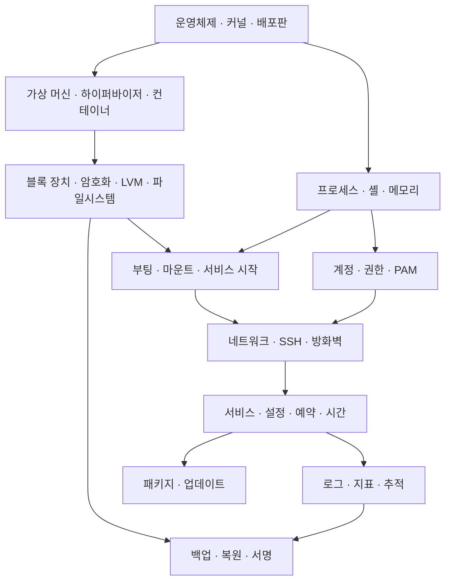

# 운영체제·Linux·가상화·서버 운영 개념 지도

서버를 만든다는 것은 서로 다른 일을 맡은 부품들을 연결하는 일이다. 커널은 실행과 접근을 중재하고, 저장 계층은 데이터를 보관하며, 서비스는 요청을 처리한다. 이 설명서는 Born2beRoot에서 만난 이름들을 출발점으로 삼아 각 부품이 **무엇이고, 왜 필요하며, 어떻게 작동하고, 다른 부품과 어떤 관계인지** 설명한다. 과제에서 직접 사용하는 기능을 넘어 컨테이너·동시성·메모리·네트워크·분산 추적·복구 설계까지 이어진다.

각 장의 본문이 설명이고, [개념 색인](concepts/inventory.md)은 본문 위치를 찾기 위한 도구다. 이 문서의 순서나 링크 목록만 읽고 설명을 대신할 수는 없다. 필요한 장부터 읽되, 낯선 선행 개념이 나오면 장 머리의 “먼저 읽기”로 돌아갈 수 있게 구성했다.

## 먼저 전체 연결을 본다

이는 학습 개념의 연결도다. 화살표는 항상 실행 순서나 엄격한 의존 관계를 뜻하지 않는다. 예를 들어 파일 권한을 이해하려면 파일 객체와 사용자 신원을 함께 알아야 하고, SSH 접속 실패를 이해하려면 네트워크와 인증을 함께 알아야 한다.

## 16개 장의 본문

| 장 | 설명하는 질문 | 이어지는 개념 |
|---|---|---|
| [01 운영체제와 Linux 배포판](concepts/01-os.md) | 커널만으로 서버가 완성되지 않는 이유는? | 시스템 호출, 사용자 공간, GNU, API·ABI, Rocky·RHEL·Debian·Ubuntu, 지원 정책 |
| [02 가상 머신과 컨테이너](concepts/02-virtualization.md) | VM·하이퍼바이저·Docker는 어느 층의 도구인가? | 호스트·게스트, 가상화, vCPU, namespace·cgroup, 이미지·볼륨 |
| [03 프로그램·프로세스·서비스](concepts/03-process.md) | 파일에 있던 프로그램이 실행되면 무엇이 생기는가? | PID·스레드, fork·exec, 문맥 교환, IPC·경쟁·잠금, 시그널, systemd |
| [04 셸·터미널·입출력](concepts/04-shell.md) | 명령창의 입력이 프로그램 사이의 데이터 흐름이 되는 과정은? | TTY·PTY, 파일 디스크립터, 파이프, 인용·확장, 환경, 종료 상태 |
| [05 하드웨어 자원과 메모리](concepts/05-memory.md) | 각 프로그램이 자기 메모리를 가진 것처럼 보이는 이유는? | CPU·ISA, 가상 주소·페이지·MMU, COW, 캐시·writeback, swap·OOM |
| [06 파일·디렉터리·마운트](concepts/06-files.md) | 이름을 지웠는데 디스크 공간이 돌아오지 않는 이유는? | 경로, inode·링크, 열린 파일, 마운트·fstab, VFS·procfs·tmpfs |
| [07 저장장치·암호화·LVM](concepts/07-storage.md) | 디스크부터 /home까지 어떤 층을 거치는가? | 파티션, ext4·XFS, 저널, LUKS, PV·VG·LV, RAID·thin·discard |
| [08 전원에서 로그인까지의 부팅](concepts/08-boot.md) | 암호화된 root를 읽기 전에는 무엇이 실행되는가? | BIOS·UEFI, GRUB, initramfs·dracut, root 전환, unit 의존·순서 |
| [09 사용자·그룹·권한과 sudo](concepts/09-permissions.md) | 누가 어떤 파일과 관리 명령에 접근할 수 있는가? | UID·GID·NSS, 파일 모드·ACL, 특수 비트, 인증·인가, capability·sudo |
| [10 PAM·비밀번호·계정 정책](concepts/10-authentication.md) | 로그인 확인·비밀번호 변경·계정 만료는 어떻게 연결되는가? | 모듈·스택, authselect, 해시·salt·KDF, 품질·기간, MFA·SSSD |
| [11 네트워크](concepts/11-network.md) | 상대 컴퓨터를 찾은 뒤 그 안의 어느 프로그램에 연결하는가? | MAC·IP, 서브넷·경로, TCP·UDP·포트, NAT, DNS·DHCP |
| [12 SSH·암호 기술·접근 제어](concepts/12-security.md) | 암호화·상대 신원·통신 허용·파일 접근은 어떻게 다른가? | 키 교환·서명·TLS, SSH 키, 방화벽·zone, DAC·MAC, SELinux·AppArmor |
| [13 배포판·패키지·업데이트](concepts/13-packages.md) | 프로그램 파일 하나보다 패키지 관리가 더 하는 일은? | 컴파일·링크, RPM·deb·DNF·APT, 의존성·서명, 백포트·롤백 |
| [14 서버 서비스·예약 실행·시간](concepts/14-services.md) | 요청 처리와 설정 적용, 시간에 따른 실행을 어떻게 관리하는가? | 동시성·이벤트 루프, 프록시, 상태, reload·restart, cron·timer, NTP |
| [15 로그·지표·추적](concepts/15-observability.md) | 출력된 숫자와 기록으로 어디까지 판단할 수 있는가? | journal·audit·회전, counter·gauge·histogram, latency·load, SLI·SLO |
| [16 백업·복구·서명](concepts/16-backup.md) | 복사본이 있다는 것과 복구할 수 있다는 것은 왜 다른가? | 일관성, 스냅샷·복제, 백업 방식, RPO·RTO, UUID·SHA-1·무결성 |

디렉터리별 위치와 용도를 찾으려면 [Linux 디렉터리 지도](directories.md)를 읽는다. 06장의 파일·마운트 원리를 `/etc`·`/usr`·`/var` 등 실제 계층과 b2br 경로로 확장한 참조 문서다.

## 깊이를 조절하며 읽기

처음에는 01~04에서 “커널 위에 프로세스가 실행되며 VM과 컨테이너가 실행 환경을 다르게 나눈다”는 구조를 잡는다. 이어 06~08에서 저장·부팅을, 09~12에서 접속과 권한을 연결한다. 당장 문제가 있는 장을 먼저 읽어도 된다. 05의 메모리 내부 구조, 03의 동시 실행 문제, 13~16의 운영·관측·복구는 처음에는 역할을 이해하고 실제 질문이 생길 때 메커니즘을 다시 읽을 수 있다.

심화 개념도 본문에 설명해 두었다. 지금 직접 적용하지 않았다는 이유로 삭제하거나 이름만 남기지 않는다. 반대로 읽은 내용을 VM에 전부 설치하거나 설정할 필요도 없다. 예를 들어 Docker는 커널 공유와 이미지·실행 상태의 차이를 배우는 비교 대상이고, 분산 추적은 한 서버의 로그에서 여러 서비스의 요청 경로로 시야를 넓히는 개념이다.

공식 자료는 각 장 끝에서 설명의 근거로 연결한다. 입문 본문으로 구조를 잡은 뒤 API·옵션·버전 차이를 확인할 때 공식 매뉴얼로 내려간다. 파일·명령 이름은 개념이 실제로 만나는 지점을 보여 주기 위해 사용하며, 줄마다 문법을 번역하는 방식으로 구성하지 않았다.

## 설명과 실제 수행 기록의 경계

현재 학습 사례로 Rocky Linux 10.2 Minimal·VirtualBox, LUKS 위 LVM, SSH 4242, firewalld·SELinux 구성을 사용한다. 이는 기존 학습 기록의 구성을 설명에 활용한 것이며 이 문서를 작성하면서 VM을 다시 확인한 결과가 아니다. “가상의 예”, 문서용 IP, SLO 예시 등은 이해를 돕는 가정이다. 개념 설명 자체가 설치·복구·보안 검증의 성공 근거가 되지는 않는다.

| 필요한 내용 | 담당 문서 |
|---|---|
| 이름의 뜻·필요성·메커니즘·차이 | 이 개념 설명서와 [색인](concepts/inventory.md) |
| 현재 구성 목표·문제 진단·복구 판단 | [targets](targets.md), [저장장치](operations/storage.md), [계정·접속](operations/access.md), [유지 관리](operations/maintenance.md) |
| 반복 실행의 명령·설정과 기대 결과 | [치트시트](cheatsheet.md) |
| 새로 구축할 때 필수 입력만 보기 | [스피드런](speedrun.md) |
| 직접 적용하고 확인한 사실·미확인 사항 | [학습 기록](learning-log.md) |
| 공식 제출 요구와 독립 제출 설명 | [원문](../en.subject.pdf), [제출용 README](../submission/README.md) |

학습 기록에는 읽었거나 설명을 작성했다는 이유로 실습 완료를 추가하지 않는다. 실제 적용과 확인의 근거가 생겼을 때 해당 사실만 남긴다.
