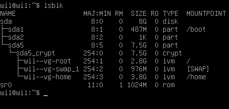
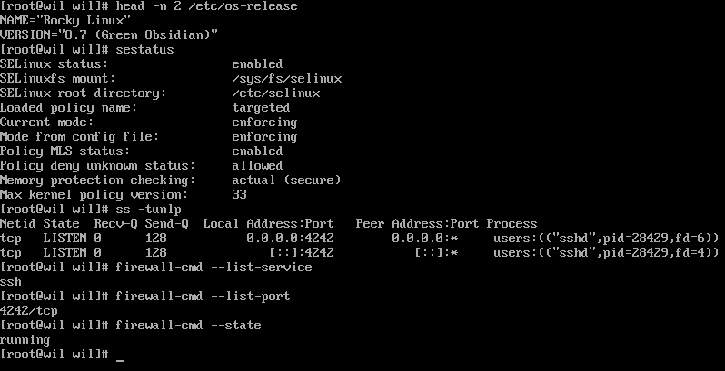
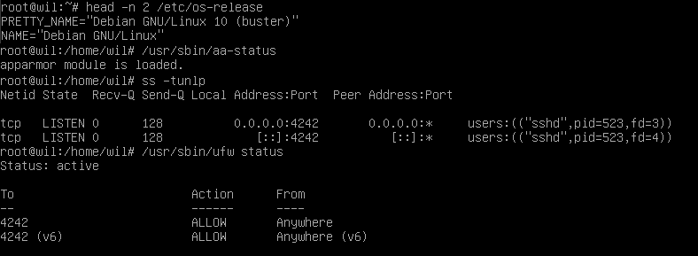
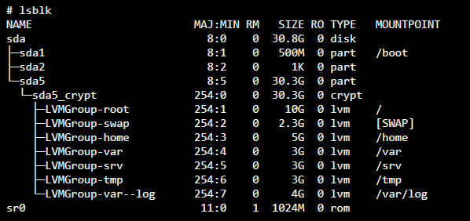

# Born2beRoot — 한국어 전체 번역

**버전: 5.2**\
**요약:** 이 문서는 시스템 관리에 관한 과제입니다.\
**원문:** `JaybinL33/b2br` 저장소의 `en.subject.pdf`.

이 문서는 원문의 모든 장, 요구사항, 주의사항, 예시와 이미지 속 주요 정보를 한국어로 옮겼습니다. 페이지 표기는 원문에 인쇄된 번호를 따릅니다. 표지는 번호가 없으며, PDF 뷰어의 페이지 번호는 아래 번호보다 1 큽니다. 원문 명령어, 파일명, 경로와 출력 예시는 정확한 식별을 위해 그대로 유지했습니다. 원문에 대한 설명은 **[번역자 주]**로 구분합니다.

## 목차 — 원문 1쪽

| 장 | 제목 | 원문 페이지 |
|---|---|---|
| I | 서문 | 2 |
| II | 소개 | 3 |
| III | AI 사용 지침 | 4–5 |
| IV | 일반 지침 | 6 |
| V | 필수 과제 | 7–11 |
| VI | README 요구사항 | 12–13 |
| VII | 보너스 과제 | 14–15 |
| VIII | 제출 및 동료 평가 | 16–17 |

## I. 서문 — 원문 2쪽


이미지에 적힌 문구:

- **YOU CAN DO ANYTHING YOU WANT TO DO:** 여러분은 하고 싶은 무엇이든 할 수 있습니다.
- **VIRTUAL MACHINE:** 가상 머신.
- **THIS IS YOUR WORLD:** 이것은 여러분의 세계입니다.

## II. 소개 — 원문 3쪽

이 프로젝트는 여러분을 가상화의 멋진 세계로 안내하는 것을 목표로 합니다.

주어진 지침에 따라 VirtualBox에서 첫 번째 가상 머신을 만들게 됩니다. VirtualBox를 사용할 수 없다면 UTM을 사용합니다. 이 프로젝트를 마치면 엄격한 규칙을 적용하면서 자신만의 운영체제를 구성할 수 있게 될 것입니다.

## III. AI 사용 지침 — 원문 4–5쪽

### 배경

이 프로젝트는 42 교육의 가장 기초적인 구성 요소를 알아가도록 설계되었습니다.

핵심 지식과 기술을 제대로 정착시키려면 AI 도구와 지원을 신중하게 활용하는 태도가 꼭 필요합니다.

진정한 기초 학습에는 도전, 반복, 동료와의 학습 교류를 통한 실질적인 지적 노력이 필요합니다.

학습 도구로서의 AI, 42 교육의 일부로서의 AI, 취업 시장에서 기대되는 AI 역량에 관한 우리의 입장을 더 자세히 알고 싶다면 인트라넷의 관련 FAQ를 확인하세요.

### 핵심 메시지

- 지름길에 의존하지 말고 탄탄한 기초를 쌓으세요.
- 기술 역량과 파워 스킬을 실질적으로 발전시키세요.
- 진정한 동료 학습을 경험하고, 학습하는 법과 새로운 문제를 해결하는 법을 배우기 시작하세요.
- 결과보다 학습 과정이 더 중요합니다.
- AI와 관련된 위험을 배우고, 흔한 함정을 피하기 위한 효과적인 통제 습관과 대응책을 마련하세요.

**[번역자 주]** 원문의 *power skills*는 소통, 협업, 문제 해결 같은 비기술적 역량을 가리키는 표현입니다.

### 학습자 규칙

- 주어진 과제에 대해 스스로 추론해야 합니다. 특히 AI의 도움을 받기 전에 먼저 그렇게 해야 합니다.
- AI에게 직접적인 정답을 요청해서는 안 됩니다.
- AI에 관한 42의 전반적인 접근 방식을 알아야 합니다.

### 이 단계에서 얻을 성과

이 기초 단계에서는 다음과 같은 성과를 얻게 됩니다.

- 올바른 기술 및 코딩 기초를 갖춥니다.
- 이 단계에서 AI가 왜, 어떻게 위험할 수 있는지 이해합니다.

### 설명과 예시

- 그렇습니다. 우리도 AI가 존재한다는 사실을 알고 있으며, AI가 여러분의 프로젝트를 해결할 수 있다는 것도 알고 있습니다. 하지만 여러분이 여기 있는 이유는 배우기 위해서이지, AI가 학습했다는 사실을 증명하기 위해서가 아닙니다. AI가 주어진 문제를 해결할 수 있다는 사실만 보여주려고 여러분이나 우리의 시간을 낭비하지 마세요.
- 42에서의 학습은 답을 아는 데 있지 않습니다. 답을 찾아내는 능력을 기르는 데 있습니다. AI는 답을 바로 제공하지만, 그러면 여러분이 스스로 추론 능력을 기르지 못하게 됩니다. 추론에는 시간과 노력, 실패가 필요합니다. 성공에 이르는 길은 쉬워야 하는 길이 아닙니다.
- 시험에서는 AI를 사용할 수 없다는 점을 기억하세요. 인터넷도, 스마트폰도 사용할 수 없습니다. 학습 과정에서 AI에 지나치게 의존했다면 이를 금방 깨닫게 될 것입니다.
- 동료 학습은 서로 다른 생각과 접근 방식을 접하게 하며, 대인관계 능력과 다양한 방향으로 사고하는 능력을 향상시킵니다. 이는 봇과 대화하는 것보다 훨씬 가치 있습니다. 그러니 주저하지 말고 서로 이야기하고, 질문하고, 함께 배우세요!
- AI는 학습 도구로서도, 학습 주제 자체로서도 교육과정의 일부가 될 것입니다. 여러분만의 AI 소프트웨어를 만들어 볼 기회도 있습니다. 우리가 단계적으로 역량을 높여 가는 방식에 대해 더 알고 싶다면 인트라넷의 관련 문서를 살펴보게 될 것입니다.

**좋은 사례**

> 새로운 개념에서 막힙니다. 가까이에 있는 동료에게 어떻게 접근했는지 물어봅니다. 10분 동안 이야기하다가 갑자기 이해가 됩니다. 개념을 깨닫습니다.

**나쁜 사례**

> 몰래 AI를 사용하고, 맞아 보이는 코드를 복사합니다. 동료 평가에서는 그 코드를 설명하지 못합니다. 평가에 실패합니다. 시험에서는 AI가 없으니 다시 막힙니다. 또 실패합니다.

## IV. 일반 지침 — 원문 6쪽

- VirtualBox를 반드시 사용해야 합니다. VirtualBox를 사용할 수 없다면 UTM을 사용해야 합니다.
- 저장소 루트에는 `signature.txt` 파일만 제출하면 됩니다. 이 파일에 가상 머신의 가상 디스크 서명을 붙여 넣어야 합니다. 자세한 내용은 「제출 및 동료 평가」를 참고하세요.
- 각 평가가 시작될 때 스냅샷이 존재해서는 안 됩니다.

**[번역자 주 — 제출 파일에 관한 원문 차이]** 이 장에서는 `signature.txt`만 제출한다고 설명하지만, VI장과 VIII장에서는 `README.md`도 요구합니다. 뒤의 구체적인 제출 요구사항을 함께 읽으면 제출 대상은 `README.md`와 `signature.txt`입니다. 위 문장은 원문 표현을 그대로 번역한 것입니다.

## V. 필수 과제 — 원문 7–11쪽

이 프로젝트는 정해진 규칙에 따라 여러분의 첫 번째 서버를 구성하는 과제입니다.

### 1. 운영체제와 기본 환경 — 원문 7쪽

> **주의:** 서버를 구성하는 과제이므로 최소한의 서비스만 설치합니다. 따라서 그래픽 인터페이스는 필요하지 않습니다. X.org, Wayland 또는 이에 준하는 다른 그래픽 서버를 설치하는 것은 금지됩니다. 이를 어기면 점수는 **0점**입니다.

운영체제는 **Debian의 최신 안정 버전** 또는 **Rocky의 최신 안정 버전** 중에서 선택해야 합니다. Debian의 testing/unstable 버전은 사용할 수 없습니다. 시스템 관리를 처음 배우는 경우 Debian을 강력히 권장합니다.

> **참고:** Rocky 설정은 상당히 복잡합니다. 따라서 KDump를 설정할 필요는 없습니다. 하지만 SELinux는 부팅 시 실행되어야 하며, 프로젝트 요구에 맞게 설정해야 합니다. Debian에서도 AppArmor가 부팅 시 실행되어야 합니다.

### 2. 암호화 파티션과 LVM — 원문 7–8쪽

LVM을 사용하여 **최소 2개의 암호화된 파티션**을 만들어야 합니다. 아래는 가능한 파티션 구성의 예시입니다.



그림의 `lsblk` 출력에서 핵심 구조를 옮기면 다음과 같습니다. 장치 이름과 크기는 원문의 예시입니다.

```text
sda                            8G   disk
├─sda1                       487M   part   /boot
├─sda2                         1K   part
└─sda5                       7.5G   part
  └─sda5_crypt               7.5G   crypt
    ├─wil--vg-root           2.8G   lvm    /
    ├─wil--vg-swap_1         976M   lvm    [SWAP]
    └─wil--vg-home           3.8G   lvm    /home
sr0                         1024M   rom
```

**[번역자 주]** 원문은 “LVM을 사용한 암호화 파티션”이라고 표현합니다. 예시 그림은 암호화 장치인 `sda5_crypt` 내부에 LVM 논리 볼륨들을 두는 구조입니다. 이 설명은 그림의 계층을 풀어쓴 것이며, 본문의 최소 개수 조건을 변경하는 뜻이 아닙니다.

> **참고:** 구두 평가에서는 선택한 운영체제에 관한 질문을 받습니다. 예를 들어 `aptitude`와 `apt`의 차이, SELinux나 AppArmor가 무엇인지 알아야 합니다. 자신이 사용하는 것을 이해하세요!

> **참고:** 예시에 나온 디스크 크기는 임의의 값입니다. 불필요한 디스크 사용을 피하면서 시스템이 제대로 작동하도록 각 파티션의 적절한 크기를 직접 결정해야 합니다.

### 3. SSH와 방화벽 — 원문 8쪽

가상 머신에서 SSH 서비스가 **4242번 포트**로 실행되어야 합니다. 보안상의 이유로 **root 계정으로 SSH 접속할 수 없어야 합니다.**

> **참고:** 구두 평가에서는 새 계정을 만들어 SSH 사용을 확인합니다. 따라서 SSH가 어떻게 동작하는지 이해해야 합니다.

운영체제에 UFW 방화벽을 설정해야 하며, Rocky에서는 firewalld를 사용해야 합니다. 가상 머신에는 **4242번 포트만 열어 두어야 합니다.**

> **참고:** 가상 머신을 시작할 때 방화벽이 활성화되어 있어야 합니다. Rocky에서는 UFW 대신 firewalld를 사용해야 합니다.

### 4. 호스트명과 사용자 — 원문 8쪽

- 가상 머신의 호스트명은 **자신의 로그인 이름 뒤에 `42`를 붙인 이름**이어야 합니다. 예: `wil42`. 동료 평가 중에 이 호스트명을 변경해야 합니다.
- 강력한 비밀번호 정책을 구현해야 합니다.
- 엄격한 규칙에 따라 sudo를 설치하고 설정해야 합니다.
- root 사용자 외에 **자신의 로그인 이름을 사용자명으로 하는 사용자**가 있어야 합니다.
- 이 사용자는 **`user42`와 `sudo` 그룹**에 속해야 합니다.

> **참고:** 동료 평가 중에 새로운 사용자를 만들고 그 사용자를 그룹에 추가해야 합니다.

### 5. 강력한 비밀번호 정책 — 원문 8–9쪽

다음 요구사항을 충족해야 합니다.

- 비밀번호는 **30일마다 만료**되어야 합니다.
- 비밀번호 변경 사이의 최소 간격은 **2일**로 설정해야 합니다.
- 비밀번호가 만료되기 **7일 전**부터 사용자에게 경고 메시지를 알려야 합니다.
- 비밀번호는 **최소 10자**여야 합니다. 대문자, 소문자, 숫자가 포함되어야 합니다. 동일한 문자가 **3자를 초과하여 연속**으로 나와서는 안 됩니다.
- 비밀번호에 사용자 이름이 포함되어서는 안 됩니다.
- 새 비밀번호에는 이전 비밀번호에 없었던 문자가 **최소 7개** 포함되어야 합니다. **이 규칙은 root 비밀번호에 적용되지 않습니다.**
- 물론 root 비밀번호도 이 비밀번호 정책을 준수해야 합니다.

**[번역자 주]** 마지막 문장은 앞서 명시한 root 예외를 없애는 뜻이 아닙니다. root에는 “이전 비밀번호에 없던 문자 최소 7개” 조건만 제외되고, 나머지 정책은 적용됩니다.

> **참고:** 설정 파일을 구성한 뒤에는 root 계정을 포함해 가상 머신에 존재하는 모든 계정의 비밀번호를 변경해야 합니다.

### 6. sudo 설정 — 원문 9쪽

sudo 그룹에 강력한 설정을 적용하려면 다음 요구사항을 충족해야 합니다.

- sudo 인증 중 비밀번호를 잘못 입력했을 때 인증 시도는 **3회**로 제한해야 합니다.
- sudo 사용 중 잘못된 비밀번호를 입력하면 직접 정한 사용자 지정 메시지를 표시해야 합니다.
- sudo로 수행하는 각 작업의 **입력과 출력 모두**를 기록해야 합니다. 로그 파일은 **`/var/log/sudo/`** 폴더에 저장해야 합니다.
- 보안을 위해 **TTY 모드**를 활성화해야 합니다.
- 보안을 위해 sudo에서 사용할 수 있는 경로를 제한해야 합니다. 예:

```text
/usr/local/sbin:/usr/local/bin:/usr/sbin:/usr/bin:/sbin:/bin:/snap/bin
```

### 7. monitoring.sh — 원문 10쪽

마지막으로 `monitoring.sh`라는 간단한 스크립트를 만들어야 합니다. **Bash로 작성해야 합니다.**

서버가 시작할 때, 그리고 이후 **10분마다**, 아래 정보를 **모든 터미널**에 표시해야 합니다. `wall`을 살펴보세요. 배너는 선택 사항입니다. 오류가 표시되어서는 안 됩니다.

스크립트는 항상 다음 정보를 표시할 수 있어야 합니다.

1. 운영체제 아키텍처와 커널 버전.
2. 물리 프로세서 수.
3. 가상 프로세서 수.
4. 서버에서 현재 사용 가능한 RAM과 사용률(%).
5. 서버에서 현재 사용 가능한 저장 공간과 사용률(%).
6. 현재 CPU 사용률(%).
7. 마지막 재부팅 날짜와 시간.
8. LVM 활성 여부.
9. 활성 연결 수.
10. 서버를 사용하는 사용자 수.
11. 서버의 IPv4 주소와 MAC(Media Access Control) 주소.
12. sudo 프로그램으로 실행한 명령 수.

> **참고:** 동료 평가 중 이 스크립트의 작동 방식을 설명해야 합니다. 스크립트 자체를 수정하지 않고 실행을 중단할 수도 있어야 합니다. `cron`을 살펴보세요.

다음은 스크립트가 어떻게 동작해야 하는지 보여 주는 예시입니다.

```text
Broadcast message from root@wil (tty1) (Sun Apr 25 15:45:00 2021):

    #Architecture: Linux wil 4.19.0-16-amd64 #1 SMP Debian 4.19.181-1 (2021-03-19) x86_64 GNU/Linux
    #Physical CPU: 1
    #vCPU: 1
    #Memory Usage: 74/987MB (7.50%)
    #Disk Usage: 1009/2Gb (49%)
    #CPU load: 6.7%
    #Last boot: 2021-04-25 14:45
    #LVM use: yes
    #TCP Connections: 1 ESTABLISHED
    #User log: 1
    #Network: IP 10.0.2.15 (08:00:27:51:9b:a5)
    #Sudo: 42 cmd
```

출력 항목의 뜻: 아키텍처, 물리 CPU 수, 가상 CPU 수, 메모리 사용량, 디스크 사용량, CPU 부하, 마지막 부팅 시각, LVM 사용 여부, TCP 연결 수, 로그인 사용자 수, 네트워크 주소, sudo 명령 수입니다. 첫 줄은 `root@wil`이 보낸 터미널 전체 방송 메시지와 전송 시각을 나타냅니다.

**[번역자 주 — 본문과 예시의 표현 차이]** 원문 본문은 RAM과 저장 공간의 “현재 사용 가능한” 양이라고 쓰지만, 출력 예시는 `Memory Usage`와 `Disk Usage`, 즉 사용량/전체 용량 형식입니다. 활성 연결 수의 예시도 TCP의 `ESTABLISHED` 연결로 표시됩니다. 이 번역은 본문과 예시를 모두 보존했습니다. 출력 형식을 결정할 때 두 부분과 적용되는 평가 기준을 함께 확인하세요.

### 8. 요구사항 확인 예시 — 원문 11쪽

다음은 과제의 일부 요구사항을 확인할 때 사용할 수 있는 명령 예시입니다.

**[번역자 주]** 원문은 “두 명령”이라고 쓰지만 실제로는 Rocky와 Debian용 **두 개의 화면 예시**에 여러 명령이 들어 있습니다. 아래에서는 이미지 속 명령을 모두 옮깁니다. 운영체제 버전과 PID 등은 화면의 예시 값이며, 최신 안정 버전 설치 요구를 대체하지 않습니다.

#### Rocky의 경우



```bash
head -n 2 /etc/os-release
sestatus
ss -tunlp
firewall-cmd --list-service
firewall-cmd --list-port
firewall-cmd --state
```

이미지 속 주요 출력의 의미:

- `NAME="Rocky Linux"`, `VERSION="8.7 (Green Obsidian)"`: 예시 운영체제 이름과 버전.
- SELinux 상태는 `enabled`(활성화).
- SELinux 마운트 위치는 `/sys/fs/selinux`, 루트 디렉터리는 `/etc/selinux`.
- 로드된 정책 이름은 `targeted`.
- 현재 모드와 설정 파일상의 모드는 모두 `enforcing`(정책을 실제로 강제 적용).
- 정책 MLS 상태는 `enabled`, `deny_unknown` 상태는 `allowed`.
- 메모리 보호 검사는 `actual (secure)`, 최대 커널 정책 버전은 `33`.
- `ss` 결과: `sshd`가 `0.0.0.0:4242`와 `[::]:4242`에서 `LISTEN` 중.
- `firewall-cmd --list-service` 출력: `ssh`.
- `firewall-cmd --list-port` 출력: `4242/tcp`.
- `firewall-cmd --state` 출력: `running`(실행 중).

**[번역자 주 — 방화벽 화면의 주의점]** 이 화면에는 `ssh` 서비스 허용도 보입니다. firewalld의 기본 `ssh` 서비스 정의는 통상 22/tcp를 포함하므로, 이 출력을 그대로 복제하면 본문의 “4242만 개방” 요구와 충돌할 수 있습니다. 실제 허용 포트와 서비스 정의를 확인하고 본문 요구사항을 기준으로 판단해야 합니다.

#### Debian의 경우



```bash
head -n 2 /etc/os-release
/usr/sbin/aa-status
ss -tunlp
/usr/sbin/ufw status
```

이미지 속 주요 출력의 의미:

- `PRETTY_NAME="Debian GNU/Linux 10 (buster)"`, `NAME="Debian GNU/Linux"`: 예시 운영체제 정보.
- `apparmor module is loaded.`: AppArmor 모듈이 로드되어 있음.
- `ss` 결과: `sshd`가 `0.0.0.0:4242`와 `[::]:4242`에서 `LISTEN` 중.
- UFW 상태는 `active`(활성).
- `4242`는 `Anywhere`에서 `ALLOW`, `4242 (v6)`는 `Anywhere (v6)`에서 `ALLOW`: IPv4 및 IPv6의 4242번 포트 허용.

## VI. README 요구사항 — 원문 12–13쪽

Git 저장소의 루트에 **`README.md` 파일을 제공해야 합니다.** 이 파일의 목적은 프로젝트를 처음 접하는 동료, 직원, 채용 담당자 등이 프로젝트가 무엇인지, 어떻게 실행하는지, 관련 정보를 어디에서 찾을 수 있는지 빠르게 이해할 수 있게 하는 것입니다.

`README.md`에는 최소한 다음 내용이 포함되어야 합니다.

- **첫 번째 줄**은 이탤릭체여야 하며 다음 문구여야 합니다.

```text
This project has been created as part of the 42 curriculum by <login1>[, <login2>[, <login3>[...]]].
```

  문구의 뜻: “이 프로젝트는 `<login1>` 등이 42 교육과정의 일부로 만들었습니다.”

  **[번역자 주]** 실제 README에는 요구된 영문 문구를 쓰고 로그인 이름을 넣습니다. 대괄호는 추가 참여자 표기를 나타냅니다. 이탤릭체는 Markdown에서 문구를 `*`로 감싸는 방식으로 표시할 수 있습니다.

- **Description** 절: 프로젝트의 목표와 간단한 개요를 포함해 프로젝트를 명확하게 소개합니다.
- **Instructions** 절: 컴파일, 설치 및/또는 실행에 관련된 정보를 담습니다.
- **Resources** 절: 관련 주제의 기본 참고 자료(문서, 기사, 튜토리얼 등)를 나열합니다. AI를 어떻게 사용했는지도 설명하며, 어떤 작업과 프로젝트의 어떤 부분에 사용했는지 명시합니다.

프로젝트에 따라 사용 예시, 기능 목록, 기술적 선택 등 추가 절이 필요할 수 있습니다.

필요한 추가 사항은 아래에 명시되어 있습니다.

- 프로젝트 설명 절에서는 운영체제(Debian 또는 Rocky)를 선택한 이유와 각 운영체제의 장단점을 설명해야 합니다.
- 설정 과정에서 내린 주요 설계 결정, 즉 파티션 구성, 보안 정책, 사용자 관리, 설치한 서비스를 설명해야 합니다.
- 다음 항목들을 비교해야 합니다.
  - Debian과 Rocky Linux.
  - AppArmor와 SELinux.
  - UFW와 firewalld.
  - VirtualBox와 UTM.

> **참고:** 영어 사용을 권장합니다. 대신 소속 캠퍼스의 주된 언어를 사용해도 됩니다.

## VII. 보너스 과제 — 원문 14–15쪽

보너스 기능은 다음과 같습니다.

### 1. 파티션 구성

아래와 유사한 구조를 얻도록 파티션을 올바르게 구성합니다.



그림의 `lsblk` 출력에서 핵심 구조를 옮기면 다음과 같습니다.

```text
sda                              30.8G   disk
├─sda1                            500M   part   /boot
├─sda2                              1K   part
└─sda5                           30.3G   part
  └─sda5_crypt                   30.3G   crypt
    ├─LVMGroup-root                10G   lvm    /
    ├─LVMGroup-swap               2.3G   lvm    [SWAP]
    ├─LVMGroup-home                 5G   lvm    /home
    ├─LVMGroup-var                  3G   lvm    /var
    ├─LVMGroup-srv                  3G   lvm    /srv
    ├─LVMGroup-tmp                  3G   lvm    /tmp
    └─LVMGroup-var--log             4G   lvm    /var/log
sr0                              1024M   rom
```

### 2. WordPress 웹사이트

다음 서비스를 사용하여 정상 작동하는 WordPress 웹사이트를 구성합니다.

- lighttpd.
- MariaDB.
- PHP.

### 3. 추가 서비스

유용하다고 생각하는 서비스를 하나 선택해 구성합니다. **NGINX와 Apache2는 제외됩니다!** 구두 평가에서 선택한 이유를 설명해야 합니다.

> **참고:** 예시에 나온 디스크 크기는 임의의 값입니다. 불필요한 디스크 사용을 피하면서 시스템이 제대로 작동하도록 각 파티션의 적절한 크기를 직접 결정해야 합니다.

> **참고:** 보너스 과제를 완료하기 위해 추가 서비스를 구성할 수 있습니다. 이 경우 필요에 따라 포트를 더 열 수 있습니다. 당연히 UFW/firewalld 규칙도 그에 맞게 조정해야 합니다.

> **주의:** 보너스 과제는 필수 과제가 **완벽할 때만** 평가합니다. 완벽하다는 것은 필수 과제를 모두 완료하고, 오작동 없이 정상적으로 작동한다는 뜻입니다. 필수 요구사항을 **전부** 통과하지 못하면 보너스 과제는 평가하지 않습니다.

## VIII. 제출 및 동료 평가 — 원문 16–17쪽

Git 저장소 루트에 요구된 **`README.md` 파일과 `signature.txt` 파일**만 제출하면 됩니다. `signature.txt`에는 가상 머신의 가상 디스크 서명을 붙여 넣어야 합니다.

서명을 얻으려면 먼저 기본 설치 폴더, 즉 가상 머신이 저장되는 폴더를 엽니다.

| 플랫폼 | 기본 가상 머신 저장 위치 |
|---|---|
| Windows | `%HOMEDRIVE%%HOMEPATH%\VirtualBox VMs\` |
| Linux | `~/VirtualBox VMs/` |
| Mac M1 | `~/Library/Containers/com.utmapp.UTM/Data/Documents/` |
| macOS | `~/VirtualBox VMs/` |

그다음 가상 머신의 `.vdi` 파일에서 **SHA-1 형식**의 서명을 구합니다. UTM 사용자는 `.qcow2` 파일을 사용합니다. 아래는 `rocky_serv.vdi`에 대한 네 가지 명령 예시입니다. Mac M1 예시에서는 UTM 디스크 경로를 사용합니다.

**Windows**

```text
certUtil -hashfile rocky_serv.vdi sha1
```

**Linux**

```bash
sha1sum rocky_serv.vdi
```

**Mac M1**

```bash
shasum rocky.utm/Images/disk-0.qcow2
```

**macOS**

```bash
shasum rocky_serv.vdi
```

다음은 얻을 수 있는 출력의 예시입니다.

```text
6e657c4619944be17df3c31faa030c25e43e40af
```

> **참고:** 가상 머신을 다시 시작하면 가상 머신의 서명이 변경된다는 점에 유의하세요. 모든 평가에서 서명을 확인할 수 있게 하려면 가상 머신의 디스크 파일을 복제하거나 각 평가에 스냅샷을 사용할 수 있습니다.

> **주의:** 가상 머신을 Git 저장소에 포함하는 것은 당연히 **금지**됩니다. 구두 평가에서는 `signature.txt`에 있는 서명과 가상 머신의 서명을 비교합니다. 두 값이 다르면 점수는 **0점**입니다.

> **주의:** 스냅샷 사용에는 제한이 있습니다. 각 구두 평가는 **스냅샷이 없는 상태**에서 시작해야 합니다. 이후 해당 평가를 위한 스냅샷을 생성하며, 평가가 끝나면 삭제합니다. 프로젝트를 제출하기 전에 스냅샷 기능을 시험해 보는 것을 권장합니다.

평가 중에는 프로젝트에 간단한 변경을 요청받을 수 있습니다. 작은 동작 변경, 몇 줄의 코드 작성이나 수정, 간단히 추가할 수 있는 기능 등이 해당됩니다.

모든 프로젝트에서 이 단계가 적용되는 것은 아닙니다. 하지만 평가 지침에 명시되어 있다면 준비해야 합니다.

이 단계는 프로젝트의 특정 부분을 실제로 이해하고 있는지 확인하기 위한 것입니다. 변경은 평소 사용하는 환경 등 원하는 개발 환경에서 수행할 수 있어야 하며, 별도의 시간이 평가 지침에 정해져 있지 않다면 몇 분 안에 완료할 수 있어야 합니다.

예를 들어 함수나 스크립트를 조금 수정하거나, 표시 내용을 바꾸거나, 정보를 저장하는 자료구조를 조정하는 등의 요청을 받을 수 있습니다.

범위, 대상 등 세부 사항은 평가 지침에 명시되며 프로젝트마다 다를 수 있습니다.

## 번역 보충 메모 — 원문 본문과 구분

이 문서는 과제 설명의 번역이지 설치를 완료한 결과 보고서가 아닙니다. 위 예시 버전, 용량, IP 주소, 사용자 이름과 SHA-1 값은 본인의 실제 환경 값이 아닙니다.

원문에서 특히 함께 읽어야 할 사항은 다음과 같습니다.

| 주제 | 원문 표현과 읽는 방법 |
|---|---|
| 제출 파일 | IV장은 `signature.txt`만 언급하지만 VI·VIII장은 `README.md`도 요구합니다. 두 파일을 준비합니다. |
| 운영체제 버전 | 화면의 Debian 10/Rocky 8.7은 예시입니다. 실제 요구는 최신 안정 버전입니다. |
| 비밀번호 root 예외 | 이전 비밀번호와 다른 문자 최소 7개 조건만 root 예외입니다. |
| RAM·디스크 표시 | 본문의 “사용 가능한” 양과 예시의 “사용량/전체” 표기가 다릅니다. 둘 다 확인합니다. |
| Rocky 방화벽 예시 | `ssh` 서비스 허용이 보입니다. 실제 서비스 정의와 허용 포트를 확인해 4242만 개방하는 본문 조건을 지켜야 합니다. |
| 스냅샷 | 평가 시작 전에는 없어야 합니다. 평가용 스냅샷은 시작 이후 생성하고 종료 시 삭제합니다. |
| 디스크 서명 | 예시 해시를 복사하지 않습니다. 실제 가상 디스크의 SHA-1을 사용하며, 재시작 후 변경될 수 있습니다. |
